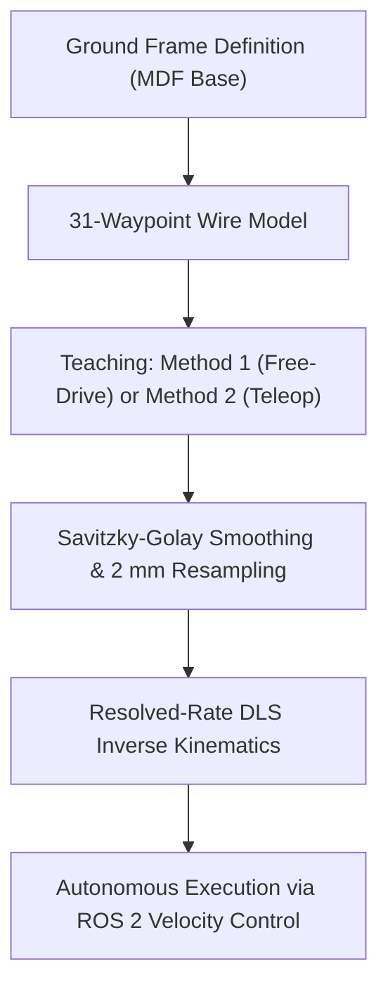

# Master Replication Guide: How to Recreate This Project From Scratch

This document provides complete, engineering-grade instructions to reproduce the entire hardware, electrical, algorithmic, and software infrastructure for both **Task 1 (Peg Sorting Robot)** and **Task 3 (Autonomous Buzz Wire Traversal)** on fresh hardware without prior configuration.

---

## 1. Hardware Bill of Materials (BOM)

### 1.1 Task 1: OpenMANIPULATOR-X Autonomous Peg Sorter
| Component | Specification | Quantity | Role |
| :--- | :--- | :---: | :--- |
| **Manipulator Arm** | ROBOTIS OpenMANIPULATOR-X (RM-X52-TNM) | 1 | 4-DOF articulated arm + 1-DOF parallel gripper. |
| **Actuators** | ROBOTIS DYNAMIXEL XM430-W350-T | 5 | Smart serial bus servos (IDs 11, 12, 13, 14, 15). |
| **Controller Interface** | ROBOTIS U2D2 (USB to RS-485 / TTL) | 1 | USB communication bridge (1 Mbps baud rate). |
| **Power Distribution** | ROBOTIS U2D2 Power Hub Board | 1 | Supplies 12V DC bus power to servos. |
| **Power Supply** | SMPS 12V DC, 5A (Barrel Jack 2.5/5.5 mm) | 1 | Main actuator power source. |
| **Vision Sensor** | Intel RealSense D435i Depth Camera | 1 | Top-down RGB-D perception (1280x720 @ 30 FPS). |
| **Camera Rig** | 2020 Aluminum Extrusion Vertical Frame | 1 | Positions camera rigidly 510 mm above table plane. |
| **Sorting Mat** | Matte Green Neoprene/Cardboard (400x500 mm) | 1 | Uniform background for color segmentation. |
| **Pegs & Sockets** | 4 Geometric Shapes (Circle, Square, Hex, Triangle) | 1 set | Colored wooden/acrylic pegs + matching socket plate. |
| **Fiducial Markers** | ArUco Markers (`DICT_4X4_50`, 38 mm square) | 2–4 | Ground-plane registration and extrinsic validation. |

---

### 1.2 Task 3: Addverb HEAL 6-DOF Cobot Buzz Wire Navigation
| Component | Specification | Quantity | Role |
| :--- | :--- | :---: | :--- |
| **Robot Arm** | Addverb HEAL Collaborative Robot | 1 | 6-DOF industrial cobot (5 kg payload, 900 mm reach). |
| **Cobot Controller** | Embedded Linux Control Box (`192.168.1.25`) | 1 | Runs real-time servo loops and `./cobot run` daemon. |
| **Buzz Wire Apparatus** | Laser-cut MDF Base & Support Posts | 1 | Base plate $332\text{ mm} \times 136\text{ mm}$, post inner span $288.0\text{ mm}$. |
| **Track Wire** | $\varnothing 4.0\text{ mm}$ Solid Copper Rod | 1 | 3D twisted track ($982.4\text{ mm}$ arc length, 4 valleys, 3 peaks). |
| **End-Effector Wand** | Copper Wire Closed Loop with Insulated Handle | 1 | Elliptical loop $27.0\text{ mm} \times 25.0\text{ mm}$ inner opening, wire $\varnothing 4.0\text{ mm}$. |
| **Buzzer Circuit** | 5V Piezo Buzzer + Red Rocker Switch + Battery | 1 | Continuity detector sounding audio alarm upon wire contact. |
| **Networking** | Gigabit Ethernet Switch & Cat6 Cables | 1 | High-bandwidth, low-latency UDP/TCP communication. |

---

## 2. Software Stack & Environment Setup

### 2.1 Operating System Matrix
* **Task 1 Workstation**: macOS (Apple Silicon M1/M2/M3 or Intel) OR Ubuntu 22.04 LTS.
* **Task 3 Workstation**: Ubuntu 22.04 LTS (required for native ROS 2 Humble) OR macOS (for offline simulation & trajectory optimization).
* **HEAL Cobot Controller**: Pre-installed real-time Linux at `192.168.1.25`.

### 2.2 System Packages & ROS 2 Installation (Ubuntu 22.04)
```bash
# Update base system
sudo apt update && sudo apt install -y \
    build-essential git curl cmake python3-pip python3-dev \
    libopencv-dev libeigen3-dev libkdl-parser-dev

# Install ROS 2 Humble Desktop (if on Ubuntu Linux workstation)
sudo apt install -y software-properties-common
sudo add-apt-repository universe
sudo curl -sSL https://raw.githubusercontent.com/ros/rosdistro/master/ros.key -o /usr/share/keyrings/ros-archive-keyring.gpg
echo "deb [arch=$(dpkg --print-architecture) signed-by=/usr/share/keyrings/ros-archive-keyring.gpg] http://packages.ros.org/ros2/ubuntu $(. /etc/os-release && echo $UBUNTU_CODENAME) main" | sudo tee /etc/apt/sources.list.d/ros2.list > /dev/null
sudo apt update && sudo apt install -y \
    ros-humble-ros-base \
    ros-humble-kdl-parser \
    ros-humble-urdf-parser-py \
    ros-humble-joint-state-publisher
```

### 2.3 Python Dependencies Installation
Create and activate an isolated virtual environment:
```bash
python3 -m venv ~/itr_env
source ~/itr_env/bin/activate
pip install --upgrade pip

# Core dependencies for Task 1 and Task 3
pip install numpy scipy opencv-python pyyaml matplotlib dynamixel-sdk pyserial
```

---

## 3. Recreating Task 1: OpenMANIPULATOR-X Peg Sorter


### Step 1: Actuator Mechanical & ID Configuration
1. Connect each Dynamixel XM430-W350-T actuator individually to the U2D2 adapter.
2. Using ROBOTIS DYNAMIXEL Wizard 2.0 or [`Project1 Task1/openmanipulator_test/01_scan_and_ping.py`](file:///Users/aai/Desktop/ITR_Proj/Project1%20Task1/openmanipulator_test/01_scan_and_ping.py), configure:
   * **Baud Rate**: `1,000,000 bps` (1 Mbps).
   * **Protocol**: `2.0`.
   * **Operating Mode**: Current-based Position Control (Address 11 = 5).
   * **Motor IDs**:
     - ID 11: Base Pan Joint (`joint1`)
     - ID 12: Shoulder Pitch Joint (`joint2`)
     - ID 13: Elbow Pitch Joint (`joint3`)
     - ID 14: Wrist Pitch Joint (`joint4`)
     - ID 15: Parallel Gripper (`gripper`)
   *(Full specs and thermal/voltage limits are cataloged in [`device/ROBOT_INFO.md`](file:///Users/aai/Desktop/ITR_Proj/Project1%20Task1/device/ROBOT_INFO.md) and [`device/SAFETY_AND_PROTECTION.md`](file:///Users/aai/Desktop/ITR_Proj/Project1%20Task1/device/SAFETY_AND_PROTECTION.md)).*

> [!CAUTION]
> **Zero Pose Calibration**:
> Assemble the arm such that at raw encoder count `2048`, Joints 12, 13, and 14 form an **L-shape** (shoulder upright, elbow horizontal forward), NOT straight up!

### Step 2: Camera Rigging & Extrinsic Hand-Eye Calibration
1. Fix the RealSense D435i overhead pointing downward at $Z \approx 510\text{ mm}$ relative to the robot base.
2. In [`Project1 Task1/`](file:///Users/aai/Desktop/ITR_Proj/Project1%20Task1), execute the automated calibration:
   ```bash
   ./run_calibration.sh
   ```
3. **Mathematical Formulation**:
   The script drives the closed gripper to 40 predefined Cartesian coordinates $(x_i, y_i, z_i)$ in the robot frame $\{B\}$. In each stance, the camera visualizes the fingertip at $(u_i, v_i)$ and ArUco markers on the table. The rigid transform $T^B_C \in SE(3)$ is solved using nonlinear Levenberg-Marquardt optimization minimizing:
   $$\min_{R, \mathbf{t}} \sum_{i} \left\| \mathbf{p}_{\text{pixel}, i} - \pi\left(K \left( R \, \mathbf{p}^B_i + \mathbf{t} \right)\right) \right\|^2$$
   Results are written to `config/camera_robot_calib.yaml`.

### Step 3: Perception & Coordinate Mapping
1. **Color Thresholding**: Convert RGB to HSV. Thresholds in `config/colors.yaml` isolate each shape:
   - Circle: Green ($H \in [35, 85]$)
   - Square: Blue ($H \in [100, 130]$)
   - Hexagon: Orange/Red ($H \in [5, 25]$)
   - Triangle: Yellow ($H \in [20, 35]$)
2. **2D-to-3D Unprojection**:
   Using camera intrinsic matrix $K$ and table height $Z_{\text{mat}}$:
   $$\begin{bmatrix} X_C \\ Y_C \\ Z_C \end{bmatrix} = Z_{\text{mat}} K^{-1} \begin{bmatrix} u \\ v \\ 1 \end{bmatrix}, \qquad \mathbf{p}_B = R^B_C \mathbf{p}_C + \mathbf{t}^B_C$$

---

## 4. Recreating Task 3: Addverb HEAL Buzz Wire Navigation



### Step 1: Geometric Modeling of the Buzz Wire Apparatus
Create the canonical Ground Frame $\{G\}$ rigidly attached to the wooden apparatus:
* **Origin $O_G = (0, 0, 0)$**: Intersection of Left MDF post inner face ($X=0$), copper wire vertical plane ($Y=0$), and top MDF board surface ($Z=0$).
* **Span & Anchors**: Left post at $X = 0.0\text{ mm}$, Right post at $X = 288.0\text{ mm}$. Wire anchors enter horizontally at $Z = 144.0\text{ mm}$.
* **Key Bends**:
  - $V_1$ (Valley 1): $X = 31.5\text{ mm}, Z = 38.0\text{ mm}$ (tightest U-bend, inner radius $11.75\text{ mm}$)
  - $P_1$ (Peak 1): $X = 86.0\text{ mm}, Z = 148.0\text{ mm}$
  - $V_2$ (Valley 2): $X = 142.0\text{ mm}, Z = 45.0\text{ mm}$
  - $P_2$ (Peak 2): $X = 175.0\text{ mm}, Z = 157.0\text{ mm}$ (highest apex)
  - $V_3$ (Valley 3): $X = 196.0\text{ mm}, Z = 25.5\text{ mm}$ (lowest trough above switch)
  - $P_3$ (Peak 3): $X = 248.0\text{ mm}, Z = 138.0\text{ mm}$
  - $V_4$ (Valley 4): $X = 265.0\text{ mm}, Z = 72.0\text{ mm}$

### Step 2: Tool Center Point (TCP) & Dynamic Orientation
The TCP frame $\{T\}$ is defined at the geometric center of the wand loop:
* **$\hat{\mathbf{z}}_T$ (Loop Normal)**: Aligned with the local wire unit tangent vector $\hat{\mathbf{t}}(s) = [\cos\alpha, 0, \sin\alpha]^T$, where $\alpha = \operatorname{atan2}(t_z, t_x)$.
* **$\hat{\mathbf{y}}_T$ (Handle Axis)**: Fixed along $[0, -1, 0]^T$ in $\{G\}$ (pointing forward out of the game base).
* **$\hat{\mathbf{x}}_T$**: Completed via $\hat{\mathbf{y}}_T \times \hat{\mathbf{z}}_T = [-\sin\alpha, 0, \cos\alpha]^T$.

Quaternion orientation for any slope angle $\alpha$:
$$\mathbf{q}(\alpha) = \left[ \cos\left(\frac{\pi}{4} + \frac{\alpha}{2}\right), \; 0, \; \sin\left(\frac{\pi}{4} + \frac{\alpha}{2}\right), \; 0 \right]$$

> [!IMPORTANT]
> **Clearance Envelope**:
> With a wand inner opening of $27.0\text{ mm} \times 25.0\text{ mm}$ and wire diameter $4.0\text{ mm}$, the radial air gap is $\delta_r = 10.5\text{ mm}$. Continuous orientation tracking ensures the effective aperture does not collapse, maintaining angular tracking error $|\Delta\alpha| \le 22.0^\circ$.

### Step 3: Kinematic Chain & Resolved-Rate Control
1. **PyKDL Tree Construction**: Parse the HEAL URDF from `/robot_description` from `base_link` to `end-effector`.
2. **Jacobian & DLS Formulation**:
   For end-effector spatial twist $\mathbf{v} = [\dot{\mathbf{p}}^T, \boldsymbol{\omega}^T]^T \in \mathbb{R}^6$ and joint rates $\dot{\mathbf{q}} \in \mathbb{R}^6$:
   $$\mathbf{v} = J(\mathbf{q}) \dot{\mathbf{q}}$$
   Compute damped pseudoinverse via Singular Value Decomposition ($J = U \Sigma V^T$):
   $$J^\dagger = \sum_{i=1}^6 \frac{\sigma_i}{\sigma_i^2 + \lambda^2} \mathbf{v}_i \mathbf{u}_i^T$$
   with Nakamura adaptive damping:
   $$\lambda^2 = \begin{cases} 0 & \sigma_{\min} \ge \sigma_0 \\ \lambda_{\max}^2 \left(1 - \frac{\sigma_{\min}}{\sigma_0}\right)^2 & \sigma_{\min} < \sigma_0 \end{cases}$$
   where $\sigma_0 = 0.04$ and $\lambda_{\max} = 0.08$.

### Step 4: Trajectory Resampling & Velocity Profiling
1. **Savitzky-Golay Smoothing**: Window length 11, polynomial order 3 removes sensor jitter.
2. **Arc-Length Resampling**: Trajectory points are resampled into exact uniform $2.0\text{ mm}$ arc segments $\Delta s$.
3. **Time-Optimal Velocity Scaling**:
   Cruise speed $v_{\text{cruise}} \in [15, 60]\text{ mm/s}$ is shaped by curvature $\kappa(s) = \|\mathbf{p}''(s)\|$:
   $$v(s) = \min\left(v_{\max}, \; \sqrt{\frac{a_{\text{normal,max}}}{\kappa(s) + \epsilon}}\right)$$
   guaranteeing smooth decelerations into tight U-bends.

---

## 5. Verification & Testing Without Hardware

You can fully test the mathematical stack offline:
```bash
cd "/Users/aai/Desktop/ITR_Proj/Project1 Task3/buzzwire_calib"

# Run kinematic forward/differential unit tests:
python3 scripts/selftest.py

# Run solver and orientation tests:
python3 scripts/selftest_solver.py

# Run virtual 6-DOF simulator with keyboard controls:
python3 scripts/selftest_teleop.py
```
Both unit tests should exit with code 0 and confirm hand-eye and trajectory residual RMS $< 0.1\text{ mm}$.
