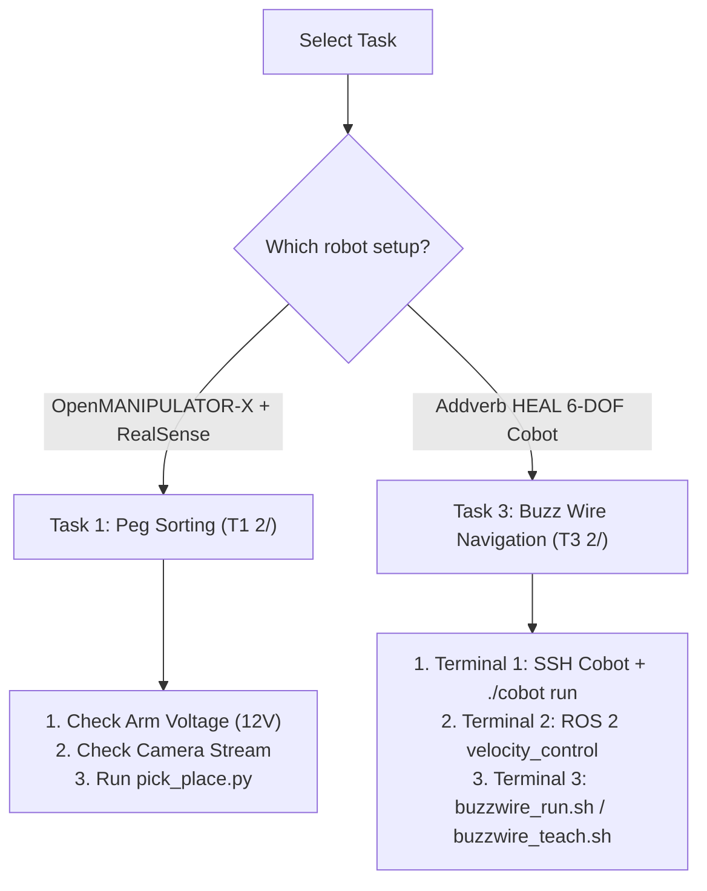

# Master Operator Runbook: How to Run the Projects

This runbook contains complete, field-tested instructions for operating both **Task 1 (Peg Sorting Robot)** and **Task 3 (Buzz Wire Robot Navigation)** across different machines (macOS laptop, Linux ROS 2 workstation, and the Addverb HEAL cobot controller).

---

## 1. Quick Decision Matrix: Which Task Are You Running?



---

## 2. Task 1: OpenMANIPULATOR-X Peg Sorting (`T1 2/`)

### 2.1 Hardware Requirements & Physical Setup
1. **Power Supply**: 12V DC, 5A connected to the ROBOTIS OpenMANIPULATOR-X power bus.
2. **U2D2 Interface**: Plugged into USB. macOS creates `/dev/cu.usbserial-*`; Linux creates `/dev/ttyUSB0`.
3. **Intel RealSense D435i**: Mounted overhead on the vertical aluminum rig pointing directly downward at the sorting mat. Use a USB 3.0 port and original high-speed cable.
4. **Tabletop Environment**: Ensure the green background mat is clear. Place colored pegs and the wooden socket plate within the camera field of view.

### 2.2 Pre-Flight Hardware Check (30 Seconds)
Open a terminal in [`T1 2/`](file:///Users/aai/Desktop/ITR_Proj/T1%202):
```bash
cd /Users/aai/Desktop/ITR_Proj/"T1 2"
```

1. **Check Arm Motors & Supply Voltage**:
   ```bash
   python3 calibration/00_check_arm.py
   ```
   *Expected Output*: Five lines reporting IDs 11, 12, 13, 14, 15 with `volt=12.0V hw_err=0x00`, ending in `ARM OK`.

2. **Verify RealSense Camera Connection**:
   * macOS:
     ```bash
     ffmpeg -f avfoundation -list_devices true -i "" 2>&1 | grep "435i RGB"
     ```
   * Linux:
     ```bash
     rs-enumerate-devices | grep "Name"
     ```

3. **Background Hardware Safety Watchdog (Optional/Recommended)**:
   To protect servos against voltage spikes (> 14.6V), brownouts (< 10.5V), or motor overheating (> 65°C), run:
   ```bash
   python3 device/hardware_protector.py
   ```
   *(Visual setup reference photos can be reviewed in [`device/images/`](file:///Users/aai/Desktop/ITR_Proj/T1%202/device/images)).*

### 2.3 Visual Perception & Layout Verification
Before moving the arm, verify what the robot sees:
```bash
# Perception check: Scans pegs and sockets, generates runs/<time>/scan1_annotated.jpg
python3 pick_place.py --detect-only

# Suggest ideal peg standing locations on live image (suggested_layout.jpg)
python3 pick_place.py --suggest-layout
```

### 2.4 Autonomous Execution Commands
| Operational Goal | Exact Command | Description |
| :--- | :--- | :--- |
| **Full Autonomous Sort** | `python3 pick_place.py` | Detects all pegs and holes, sorts all shapes in optimal path order. |
| **Custom Shape Order** | `python3 pick_place.py --order circle,square,hexagon,triangle` | Enforces specific priority; treats other shapes as collision obstacles. |
| **Single Shape Trial** | `python3 pick_place.py --shape circle` | Isolates one shape for testing (options: `circle`, `square`, `hexagon`, `triangle`). |
| **Dry-Run Planning** | `python3 pick_place.py --plan-only` | Visualizes the motion trajectory and finger sweep envelopes in `runs/<time>/plan1.jpg` without moving the arm. |
| **Force Insertion** | `python3 pick_place.py --force` | Attempts insertion even if hole visual alignment is marginally out of tolerance. |

### 2.5 Camera-to-Robot Recalibration (If Rig Moved)
If the camera rig, mat, or robot base shifted:
```bash
# Automated 40-point calibration routine (~10 minutes)
./run_calibration.sh

# Verify calibration accuracy at specific robot coordinate:
python3 calibration/02_verify_calibration.py --xy 150 60

# Interactive jog check:
python3 calibration/02_verify_calibration.py --jog
```

> [!IMPORTANT]
> **Task 1 Lab Hardware Facts**:
> * **Zero Configuration**: Joints 12–14 at 2048 counts represent an **L-shaped arm** (forearm horizontal), NOT straight vertical.
> * **Gripper Thresholds**: Fully Open = `3250 counts`; Fingers touching = `1385 counts`. Operates in Dynamixel Current-Limited Mode 5.

---

## 3. Task 3: Addverb HEAL Buzz Wire Navigation (`T3 2/`)

All active scripts are accessed via:
[`/Users/aai/Desktop/ITR_Proj/T3 2/buzzwire_calib`](file:///Users/aai/Desktop/ITR_Proj/T3%202/buzzwire_calib)

### 3.1 Network Topology & Architecture
* **HEAL Cobot Controller**: Embedded PC at IP `192.168.1.25` (SSH: `cobot@192.168.1.25`, password `cobot`).
* **Operator Workstation**: ROS 2 Humble host PC connected via gigabit Ethernet (`192.168.1.x` subnet).

```
[ Operator Laptop / Workstation ]  <==== Gigabit Ethernet ====>  [ HEAL Robot Controller (192.168.1.25) ]
  - buzzwire_run.sh / teach.sh                                      - ./cobot run (Low-level daemon)
  - PyKDL Forward Kinematics                                         - ./heal_server (Velocity control mode)
  - SVD DLS-IK Trajectory Generator                                  - ./free_drive (Gravity compensation)
  - /velocity_controller/commands ROS 2 topic                        - /joint_states publisher
```

---

### 3.2 The Standard 3-Terminal Launch Procedure

#### Terminal 1: Robot Low-Level Controller (SSH to Arm)
```bash
ssh cobot@192.168.1.25
# password: cobot

cd /home/cobot/addverb_images/gripper_fix_2026-09-08/
sudo env HOME=/home/cobot ./cobot run
# password: cobot
# When prompted, type 1 and press ENTER.

# THEN SELECT ROBOT MODE:
./heal_server        # For Method 2 (Keyboard Teleop) and Autonomous Replay
# -- OR --
./free_drive         # For Method 1 (Manual Hand-Guiding Teaching)
```

#### Terminal 2: ROS 2 Velocity Controller (On Robot or Workstation)
```bash
cd ~/Debojit_WS/addverb_ws/
source /opt/ros/humble/setup.bash
source install/setup.bash

ros2 launch addverb_cobot_control velocity_control.launch.py
```

#### Terminal 3: Buzz Wire Trajectory Runner & Operator CLI
```bash
cd "/Users/aai/Desktop/ITR_Proj/T3 2/buzzwire_calib"
```

---

### 3.3 Autonomous Replay Execution (`buzzwire_run.sh`)

Once Terminal 1 (`./heal_server`) and Terminal 2 (ROS 2 velocity launch) are running, execute autonomous traversals:

```bash
# 1. Drive arm to the Left Post (Start) from any arbitrary position:
./buzzwire_run.sh goto L

# 2. Execute Left-to-Right Wire Traversal at chosen speed profile:
./buzzwire_run.sh lr show          # 24 mm/s cruise (Demo profile, ~69s)
./buzzwire_run.sh lr balanced      # 39 mm/s cruise (Standard, ~55s)
./buzzwire_run.sh lr fast          # 60 mm/s cruise (Competition speed, ~42s)

# 3. Safely return along the wire from Right Post to Left Post:
./buzzwire_run.sh rl

# 4. Park arm in safe Home position:
./buzzwire_run.sh goto home

# 5. Non-motion speed and timing verification:
./buzzwire_run.sh dry-run lr
```

---

### 3.4 Teaching a New Wire Trajectory (`buzzwire_teach.sh`)

If the wire stand or tool mount is repositioned, teach a new trajectory:

#### Step 1: Initialize Session
```bash
./buzzwire_teach.sh new wire_run_01
```

#### Step 2: Choose Teaching Method

**Method 1: Free-Drive Hand Teaching (complaint mode)**
1. In Terminal 1, ensure `./free_drive` is running.
2. In Terminal 3:
   ```bash
   ./buzzwire_teach.sh record
   ```
3. Hand-guide the wand loop along the wire from Post L to Post R.
4. Press `SPACE` to toggle the gripper. Press `q` to finish and save segment.

**Method 2: 6-DOF Keyboard Teleoperation (millimeter precision)**
1. In Terminal 1, ensure `./heal_server` is running.
2. In Terminal 3:
   ```bash
   ./buzzwire_teach.sh teleop
   ```

**Keyboard Teleoperation Cheat Sheet**:
```
  MOVE (Hold Keys)                    ROTATE (Hold Keys)               SPECIAL ACTIONS
   w / s : Forward / Back (+Y / -Y)    i / k : Pitch Up / Down (Y)      SPACE : Gripper Open <-> Closed
   a / d : Left / Right   (-X / +X)    j / l : Yaw Left / Right (Z)     v     : Start / Stop Recording
   r / f : Up / Down      (+Z / -Z)    u / o : Roll Left / Right(X)     x     : Mark buzzer contact
                                                                        z     : HOLD TO BACKTRACK (Undo)
  SPEED PROFILE: 1 (Fine) to 5 (Fast)                                   c     : Re-sync carrot target to arm
  TAB          : Toggle jog frame (World <-> Tool)                      g     : Toggle Auto-Tangent Pitch
  ESC          : Immediate Emergency Stop + Re-sync                     q     : Quit & save segment
```

#### Step 3: Inspect, Merge & Calibrate
```bash
# Verify segment continuity, gaps (< 5 mm), and arc coverage:
./buzzwire_teach.sh inspect

# Merge raw segments, apply Savitzky-Golay smoothing, and resample at 2 mm:
./buzzwire_teach.sh merge

# Calibrate wire elevation and generate forward/reverse CSVs:
./buzzwire_run.sh calibrate
```

---

## 4. Stuck Arm Recovery Playbook & Edge Cases

### Case 1: Hard Movement or Torque Limit Trip
* **Symptom**: The HEAL controller stops responding or drops joint torque during high-acceleration moves.
* **Resolution**:
  1. In Terminal 1, press `Ctrl+C` to terminate the process.
  2. Rerun:
     ```bash
     sudo env HOME=/home/cobot ./cobot run
     ```
     Type `1` + Enter.
  3. Start `./heal_server`.
  4. In Terminal 3, recover the arm to a safe keyframe:
     ```bash
     python3 scripts/goto_target.py --target home
     ```

### Case 2: Carrot Leash Stall Protection
* **Symptom**: During replay, the arm hits mechanical resistance or joint velocity saturation.
* **Mechanism**: `replay_core.py` continuously compares the actual end-effector pose $\mathbf{p}_{\text{arm}}$ against the virtual target carrot $\mathbf{p}_{\text{carrot}}$. If $\|\mathbf{p}_{\text{arm}} - \mathbf{p}_{\text{carrot}}\| > 25\text{ mm}$, motion halts immediately with zero velocity commanded to prevent damage.
* **Resolution**: Free any physical obstruction, verify joint limits, and re-run with `--resume`.

### Case 3: Replaying from Last Known Interrupted State
If an SSH dropout or pause occurred during traversal:
```bash
# Resumes execution from the exact millimetre index where it stopped:
./buzzwire_teach.sh replay --resume
```

### Case 4: Live Backtrack During Teaching (`z` key)
If you nick the wire or take a wrong turn during keyboard teleoperation:
* **Action**: **Press and hold `z`**.
* **Result**: The controller commands the arm along the exact reverse path back to a clear point, automatically truncating the CSV recording to eliminate the erroneous motion.

---

## 5. Cross-Device Handoff: Laptop vs. Lab Workstation

When moving between your personal laptop (offline analysis/sim) and the laboratory workstation:

1. **Active Session Path Normalization**:
   The `data/ACTIVE_SESSION` pointer holds the active folder. If the absolute path belongs to another device, point it to the local directory:
   ```bash
   ./buzzwire_teach.sh use data/session_20261116_104756
   ```

2. **Offline Simulation Mode (No Hardware Needed)**:
   You can run all trajectory mathematics, visual plots, and keyboard driving in virtual simulation on any Mac or Linux machine without ROS or the robot:
   ```bash
   ./buzzwire_teach.sh sim       # Interactive simulated 6-DOF arm teleop
   ./buzzwire_teach.sh test      # Run all automated kinematics & pipeline unit tests
   ```
