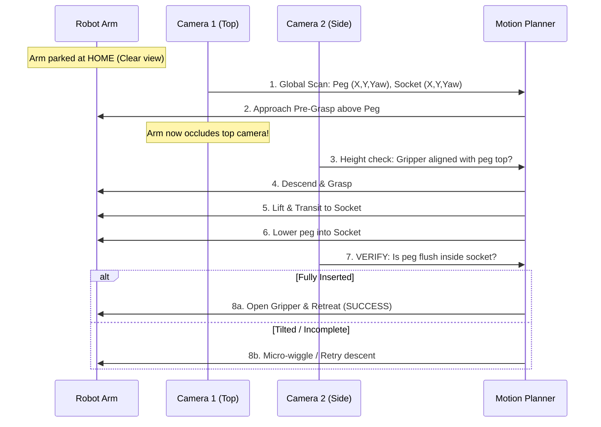

# Dual-Camera Vision Architecture & Handling Guide

This document defines how the **Overhead Top-Down Camera** and the **Bottom Side-Angle Camera** work together to achieve 100% autonomous peg sorting with zero blind spots.

---

## 1. The Two-Camera Physical Layout

```
             ┌───────────────────────────────┐
             │   CAMERA 1: TOP / OVERHEAD    │ (Looking straight down)
             └───────────────┬───────────────┘
                             │  Planar (X, Y) Coordinates
                             │  Shape & Color Detection
                             │  Yaw Angle Modulo Symmetry
                             ▼
  ┌─────────────────────────────────────────────────────────────┐
  │                                                             │
  │   [PEG PICKUP ZONE]                  [SOCKET BOARD ZONE]    │
  │       ▲       ▲                           ▲       ▲         │
  │     Yellow   Blue                       Triangle Square     │
  │     Orange  Green                       Hexagon  Circle     │
  │                                                             │
  └───────────────────────────▲─────────────────────────────────┘
                              │
             ┌────────────────┴──────────────┐
             │   CAMERA 2: BOTTOM / SIDE     │ (Looking across table)
             └───────────────────────────────┘
               • Vertical Z-Height Clearance
               • Bypasses Arm Occlusion
               • In-Socket Insertion Verification
```

---

## 2. Role Distribution: Why 2 Cameras?

| Feature / Challenge | Camera 1: Top (Overhead) | Camera 2: Bottom (Side) |
| :--- | :--- | :--- |
| **$(X, Y)$ Localization** | **Primary** (Direct orthographic view, zero skew) | Poor (perspective compression) |
| **Shape Classification** | **Primary** (Clean 2D polygon cross-section) | Hard (sees 3D prism side faces) |
| **Orientation / Yaw** | **Primary** (Direct angle detection) | Hard (cannot see top polygon corners) |
| **$Z$-Height & Table Clearance**| Secondary (relies on depth sensor) | **Primary** (Direct silhouette view) |
| **Arm Occlusion** | Blind when arm is directly over peg/socket | **Unobstructed** (looks under the gripper) |
| **Insertion Verification** | Occluded by the robot gripper/wrist | **Primary** (confirms peg is fully flush) |
| **Topple / Knock-over Check** | Cannot easily detect tipped peg | **Instant** (sees peg lying flat on table) |

---

## 3. Software Architecture: How the Code Handles Both

### A. Threaded Asynchronous Capture (`DualCameraManager`)
USB cameras on macOS can drop frames if polled sequentially. We use two background worker threads:

```python
class DualCameraManager:
    def __init__(self, top_cam_id=0, side_cam_id=1):
        self.top_cap = cv2.VideoCapture(top_cam_id)
        self.side_cap = cv2.VideoCapture(side_cam_id)
        # Dedicated background capture threads ensure zero lag
        ...
```

### B. State Machine Workflow



---

## 4. Coordinate Transformation & Calibration

Both cameras output points in their own camera coordinate frames ($\mathbf{P}_{c1}$ and $\mathbf{P}_{c2}$).
We calibrate extrinsic transformation matrices to map all observations into the unified **Robot Base Frame**:

$$\mathbf{P}_{\text{robot}} = \mathbf{R}_{\text{top}}^{\text{robot}} \mathbf{P}_{\text{top}} + \mathbf{T}_{\text{top}}^{\text{robot}}$$
$$\mathbf{P}_{\text{robot}} = \mathbf{R}_{\text{side}}^{\text{robot}} \mathbf{P}_{\text{side}} + \mathbf{T}_{\text{side}}^{\text{robot}}$$

* We place an **ArUco marker** on the tabletop at a known robot position $(X_0, Y_0, 0)$.
* Both cameras detect the marker $\to$ automatically calculates $\mathbf{R}$ and $\mathbf{T}$ with zero manual measuring!

