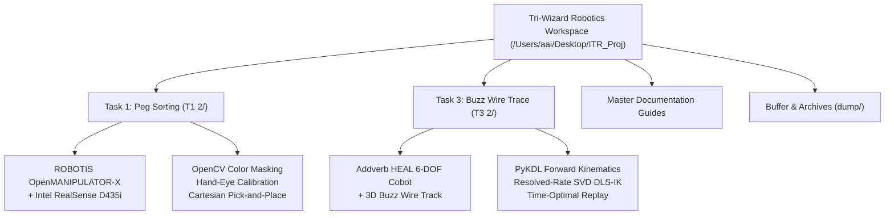

# Tri-Wizard Robotics: Autonomous Manipulation & Wire-Trace Navigation

Welcome to the unified robotics repository containing the perception, kinematics, trajectory planning, and real-time control stacks for the **Tri-Wizard Robotics Competition**.

> [!IMPORTANT]
> **Active Tested Workspaces**:
> * **Task 1 (Peg Sorting)**: [`T1 2/`](file:///Users/aai/Desktop/ITR_Proj/T1%202)
> * **Task 3 (Buzz Wire Navigation)**: [`T3 2/`](file:///Users/aai/Desktop/ITR_Proj/T3%202) (Direct working path: [`T3 2/buzzwire_calib`](file:///Users/aai/Desktop/ITR_Proj/T3%202/buzzwire_calib))
> * All legacy snapshots, early calibrations, and scratch buffers are organized under [`dump/`](file:///Users/aai/Desktop/ITR_Proj/dump) or marked as supporting.

---

## 1. System Overview & Task Matrix



| Task | Primary Working Directory | Hardware Platform | Core Capabilities |
| :--- | :--- | :--- | :--- |
| **Task 1: Peg Sorter** | [`T1 2/`](file:///Users/aai/Desktop/ITR_Proj/T1%202) | ROBOTIS OpenMANIPULATOR-X (5x Dynamixel XM430-W350-T) + Intel RealSense D435i | Overhead RGB perception, table segmentation, 40-point hand-eye calibration, hole matching, autonomous pick-and-place. |
| **Task 3: Buzz Wire** | [`T3 2/`](file:///Users/aai/Desktop/ITR_Proj/T3%202) / [`buzzwire_calib`](file:///Users/aai/Desktop/ITR_Proj/T3%202/buzzwire_calib) | Addverb HEAL 6-DOF Cobot + 3D Wire Game apparatus + Continuity Buzzer | 6-DOF resolved-rate teleop, gravity-compensated teaching, Savitzky-Golay smoothing, 2 mm arc resampling, collision-free replay ($< 45\text{s}$). |

---

## 2. Master Documentation Links

To ensure complete context persistence across shifts when moving between operator laptops and the laboratory cobot controller, refer to the following comprehensive guides:

| Document | Link | Target Audience & Purpose |
| :--- | :--- | :--- |
| **Operator Runbook** | [`HOW_TO_RUN.md`](file:///Users/aai/Desktop/ITR_Proj/HOW_TO_RUN.md) | **Lab Operators**: Step-by-step terminal guides, SSH commands, keyboard teleop controls, stuck arm recovery, and execution commands. |
| **Replication Guide** | [`HOW_TO_RECREATE.md`](file:///Users/aai/Desktop/ITR_Proj/HOW_TO_RECREATE.md) | **Developers & Reviewers**: Bill of Materials (BOM), OS/ROS setup, hand-eye calibration math, DLS kinematics formulation, and offline verification. |
| **Directory Map** | [`DIRECTORY_STRUCTURE.md`](file:///Users/aai/Desktop/ITR_Proj/DIRECTORY_STRUCTURE.md) | **Repository Architects**: Complete file tree, active vs. supporting vs. buffer categorization, and data flow diagrams. |
| **Buffer & Dump Index** | [`dump/README.md`](file:///Users/aai/Desktop/ITR_Proj/dump/README.md) | **Audit & Recovery**: Non-destructive buffer holding legacy debug images, scratch scripts, and backup archives. |

---

## 3. 60-Second Quickstart Commands

### 3.1 Task 1: Autonomous Peg Sorting
```bash
# 1. Open Terminal in active workspace:
cd /Users/aai/Desktop/ITR_Proj/"T1 2"

# 2. Check 12V supply & servo communication:
python3 calibration/00_check_arm.py

# 3. Optional: Run background watchdog protector:
python3 device/hardware_protector.py &

# 4. Verify camera vision:
python3 pick_place.py --detect-only

# 5. Execute full autonomous pick and place:
python3 pick_place.py
```

### 3.2 Task 3: Autonomous Buzz Wire Traversal
```bash
# Terminal 1 (SSH to HEAL Cobot Controller):
ssh cobot@192.168.1.25
cd /home/cobot/addverb_images/gripper_fix_2026-09-08/
sudo env HOME=/home/cobot ./cobot run     # Type 1 + ENTER
./heal_server                             # High-rate velocity mode

# Terminal 2 (ROS 2 Velocity Controller Launch):
cd ~/Debojit_WS/addverb_ws/ && source /opt/ros/humble/setup.bash && source install/setup.bash
ros2 launch addverb_cobot_control velocity_control.launch.py

# Terminal 3 (Operator Traversal Execution):
cd "/Users/aai/Desktop/ITR_Proj/T3 2/buzzwire_calib"
./buzzwire_run.sh goto L                  # Position arm at Left Post
./buzzwire_run.sh lr balanced             # Traverse wire L -> R (~55s)
./buzzwire_run.sh rl                      # Safe return wire traversal R -> L
./buzzwire_run.sh goto home               # Safely park arm
```

---

## 4. Cross-Device & File-Based Persistence

Because development and execution occur across multiple machines:
1. **No Hidden State**: All configuration parameters, calibrated transformations, and session waypoints are strictly committed as YAML, JSON, or CSV files on disk.
2. **Relative Sourcing**: Scripts automatically resolve relative to their current directory (`$HERE`) or check `data/ACTIVE_SESSION`.
3. **Offline Simulation**: The entire kinematic chain and keyboard teleoperation stack can be executed and tested on macOS/Linux without physical robot hardware via `./buzzwire_teach.sh sim` and `python3 pick_place.py --plan-only`.
